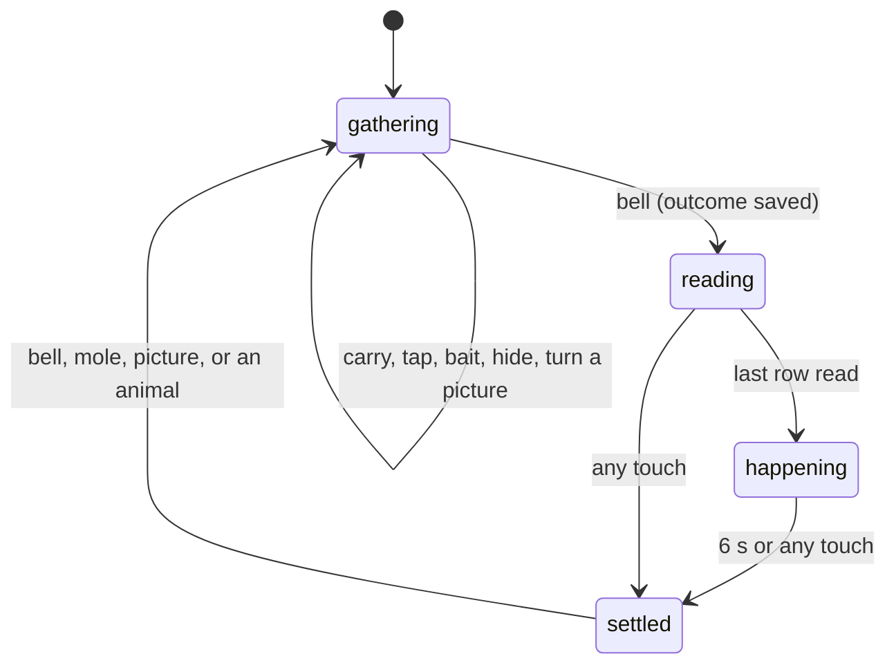

# The Animals Vote - Plan

## Goal Capsule

- **Objective:** A child of 3 to 7 makes a picture graph out of animals, sees which column has more, and lives with the result: what the tallest column wants happens to every animal in town. Weeks later the child is arranging ties on purpose.
- **Means:** a canvas 2D jam game, `games/animals-vote/`, from the cartridge template, with a pure rules module (KTD1), one pure play path (KTD2) and a contour-laid mosaic look (KTD4).
- **Authority:** `AGENTS.md`, the Tada cartridge contract, `docs/solutions/conventions/building-a-jam-game.md`, the game-design and education packs. The owner asked for a deep, finished game.
- **Stop conditions:** a shared file must change other than one row in the README games table, one in the claimed-styles registry, one line in `harness/shelves.ts` and the game's cover.
- **Ships as:** one draft pull request. The owner plays it and merges.

## Product Contract

### Summary

Two or three pictures stand under three empty columns: bath, mud, dance, fly or sleep. Each animal takes one square in the column of the thing it wants, however big or small it is. The bell reads the columns a row at a time, and what the tallest one wants happens to everybody, including whoever was hidden and whoever wanted something else.

### Problem Frame

When the idea was written up, no jam game named picture graphs in its design sheet. A graph in a school book has no consequence. Here the graph is made of bodies, the child can meddle with it, and it decides what happens.

### Requirements

- R1. Every animal takes exactly one square of one size, on a common base line with no gaps. A tap sends an animal to what it likes best or takes it down again. A drag puts it where the child wants.
- R2. Tastes are fixed. An animal put on the one thing it cannot stand goes back to where it wants to be, unless a snack it loves lies at that column.
- R3. The child meddles in five ways: carry, bait a column with a snack, hide one animal in the basket, turn a picture to another thing, open or shut the third column.
- R4. The bell first lets whoever is still on the ground run to its own favourite, then reads the columns row by row: each row hops and sounds, and a column that has run out stays still. The tallest happens to all. Where the tallest are equal, all of those happen at once.
- R5. The graph of the last vote stays on the wall while its result happens and afterwards, until the child begins another.
- R6. A mole in the bell tower holds up a picture of what it would like. It can be ignored for ever. Meeting it moves to the next; not meeting it changes nothing and nothing is said.
- R7. Lively, with no score, count, timer, praise or numeral. Wordless.
- R8. Found as left at any instant; attended time only; a result is saved when the bell is rung.
- R9. The shared quality bar, in the Mosaic tiles look. The columns are the plainest things in the picture.
- R10. The learning claim is "designed from" the named records, with adult help carried as a limit.

### Scope Boundaries

No speech, no microphone, no 3D. The look menu (section 4 of `docs/art-direction.md`) is not edited. Nothing is claimed about what a child learns. No merge and no deploy.

### Acceptance Examples

- AE1. First visit, ring the bell: three animals take mud and one takes bath; everybody is muddy, the elephant too.
- AE2. Dance against sleep with five: three to two. Move the pig to sleep: sleep wins.
- AE3. Cat carried to bath: it springs back to mud. With cheese at bath it stays.
- AE4. Pig in the basket: it is not in the graph, and the mud reaches it all the same.
- AE5. Three against three: both things happen to everyone at once, in a way neither has alone.

## Planning Contract

### Key Technical Decisions

- KTD1. **Rules are a pure state with an event list.** `town.ts` holds columns as ordered arrays of animals; every act returns events for the view and the voices. What is drawn eases toward the state and is never saved.
- KTD2. **One play path** (`play.ts`) takes pointers in stage units and seconds; the Mount and the tests use it.
- KTD3. **A result is composed, not authored per pair.** A thing gives a motion per animal, a coat, what falls and a sound. A tie plays its things together and adds one twist per pair, so ten ties come from five things.
- KTD4. **Mosaic by contour.** A shape's distance field is traced at even depths and stones are laid along each trace, so rows follow the form and no grid appears. Sprites are laid once per scale and stamped.
- KTD5. **One body, two forms.** Each animal has a large form on the ground and a squeezed form that fits one square, which is the joke and the unit in one.

### High-Level Technical Design

### Assumptions

- The look is taken without an owner checkpoint, as the owner asked for a hands-off run; the pull request lists it as a default.
- The bell ends the vote only after everyone on the ground has run to a column, so the simplest use always works.
- No child has tried the idea.

## Implementation Units

### U1. Sheet
- **Goal:** the design sheet in `games/animals-vote/ART.md` before rules, checked by a fresh reader. **Requirements:** R10. **Verification:** findings resolved.
- **Test expectation:** none, a document.

### U2. Rules and save
- **Goal:** R1 to R6, R8. **Files:** `games/animals-vote/things.ts`, `town.ts`, `save.ts`, and `town.test.ts`, `save.test.ts`.
- **Test scenarios:** AE1 to AE5; every wish reachable by a bounded search of the child's own moves; no gaps in any column after any act; corrupt saves; the largest save under half the cap.

### U3. Toy and look
- **Goal:** R1, R9. **Files:** `mosaic.ts`, `figures.ts`, `scenery.ts`, `layout.ts`, `view.ts`.
- **Test scenarios:** no two targets overlap; every square has one size and stands on the base line; nothing large covers the graph.

### U4. Play, voices, results
- **Goal:** R3 to R7. **Files:** `play.ts`, `motion.ts`, `voices.ts`, `guide.ts`, `animals-vote.tsx`, and tests.
- **Test scenarios:** the touch rules through pointers; a touch ends a scene at its end state; every animal moves differently in every result; each tie differs from its parts; frame budget.

### U5. Refine and ship
- **Goal:** logged passes, a cold playtest proxy, the perf probe, the cover, the rows. **Files:** `games/animals-vote/REFINEMENT.md`, `README.md`, `docs/art-direction.md`, `harness/shelves.ts`, `harness/covers/animals-vote.webp`.
- **Test expectation:** the repo's own checks.

## Verification Contract

`npm run check`; `npm run build && npm run egress:built && npm run education:built`; a walkthrough of the production build at 1180x820 and a narrow size with screenshots; `npm run perf:jam -- animals-vote`. Test runs use their own `TMPDIR`, deleted afterwards.

## Definition of Done

R1 to R10 hold with tests or a logged look; gates green; a draft pull request open saying how each quality-bar line is met, the defaults taken and what was not measured; no abandoned code left.
